<div align="center">

# Dabba

**A self-hosted AI assistant platform — chat, agents, tools, and automations in one place.**

Web app · Terminal TUI · VS Code extension · Chrome extension · OpenAI-compatible API

</div>

---

## Table of contents

- [What is Dabba?](#what-is-dabba)
- [Screenshots](#screenshots)
- [Architecture](#architecture)
- [Features](#features)
- [Quick start](#quick-start)
- [Configuration](#configuration)
- [Project structure](#project-structure)
- [Testing](#testing)
- [Deployment](#deployment)
- [Documentation](#documentation)

---

## What is Dabba?

Dabba is a full-stack AI assistant platform. One FastAPI backend powers several clients, and every client can switch between cloud model providers or Dabba's own from-scratch transformer.

It brings together:

- **A chat workspace** with projects, artifacts, file uploads, voice input, and exports (PDF, Word, Excel, PowerPoint)
- **An agent runtime** with planning, tool calling, MCP connectors, hooks, subagents, and scheduled skills
- **A multi-provider gateway** for Anthropic, OpenAI, Google, NVIDIA NIM, Ollama, Hugging Face, and local GGUF models
- **A from-scratch LLM stack**: BPE tokenizer, decoder-only transformer, trainer, RAG pipeline, and multimodal encoders

> [!NOTE]
> The built-in `dabba` model is small (about 8.9M parameters) and intended for experimentation and casual chat. For agentic work such as file edits, shell commands, and multi-step tasks, pick a hosted model like Claude, GPT, Gemini, or a NVIDIA NIM model from the **Agents** page.

---

## Screenshots

### Sign in

Signed-out visitors see the sign-in form at `/` or `/login`, can sign up at `/signup`, and can open guest chat at `/try` when enabled. On phones it shows the form only. The first account created on a server becomes its owner.

| Desktop | Mobile |
|---|---|
| 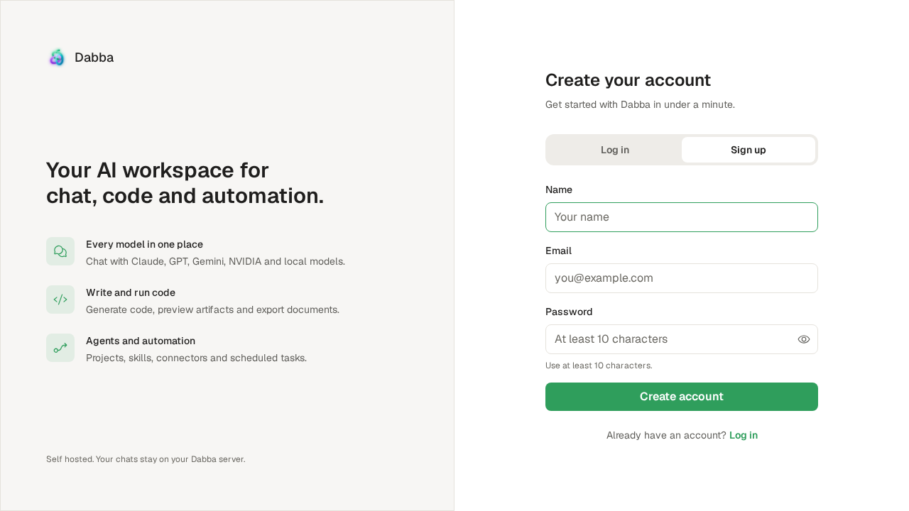 | 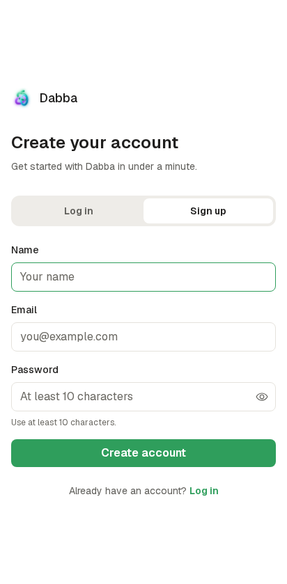 |

### Cowork

A task-first workspace. Describe the result you want, optionally point it at a project folder, and Dabba works on it with tools and connectors enabled.

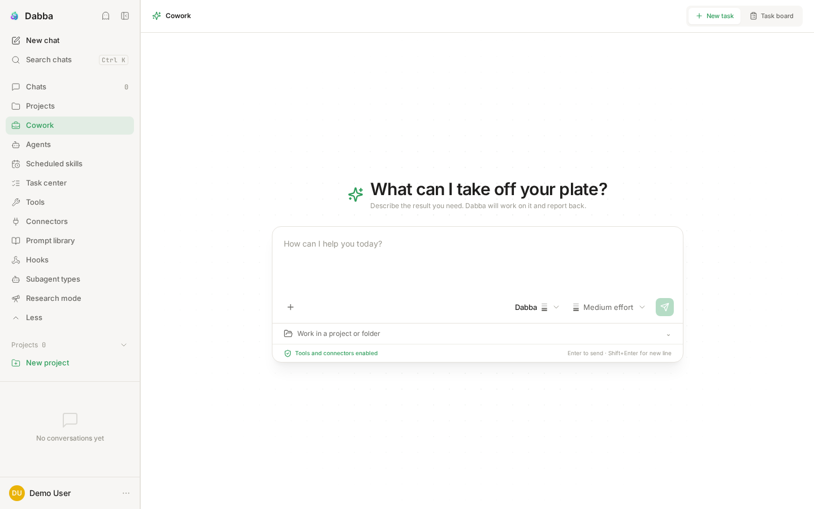

### Agents (model picker)

Each available model, grouped by provider, with an effort badge (`LOW` → `MAX`). Providers that need a key prompt for it on first use.

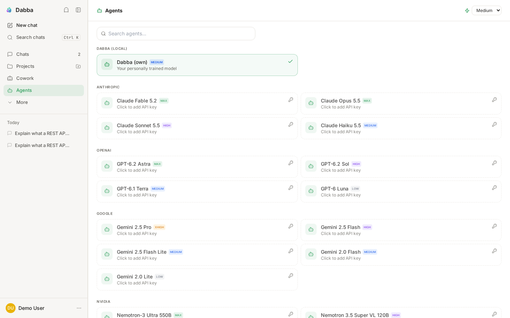

### Connectors

MCP connectors for GitHub, Google Drive, Microsoft 365, AWS, Azure, Slack, Jira, Linear, Notion, Figma, and more. Installed connectors show live status.

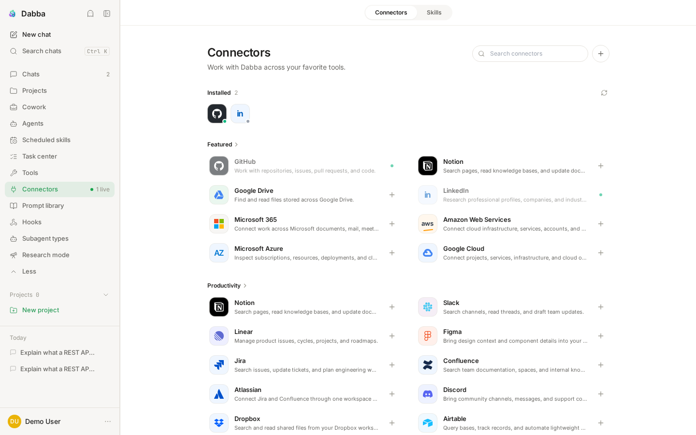

### Projects

Group related conversations and give them shared instructions.

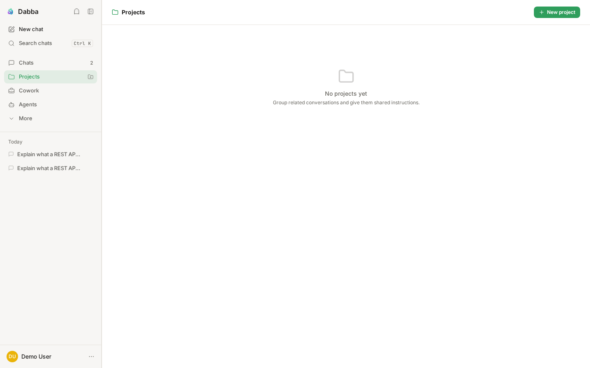

### Prompt library (skills)

Saved instructions that Dabba applies to matching messages automatically. Any `SKILL.md` file can be imported.

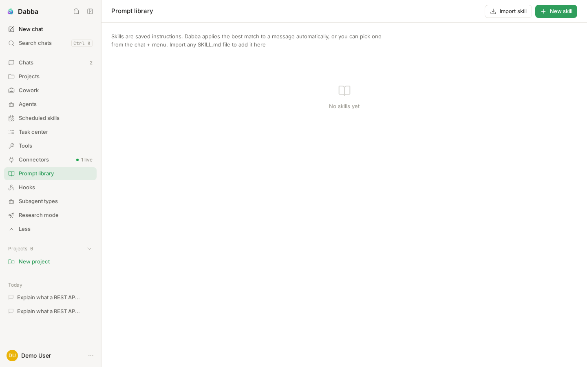

### Scheduled skills

Run reusable instructions on a schedule, with durable queueing and run history.

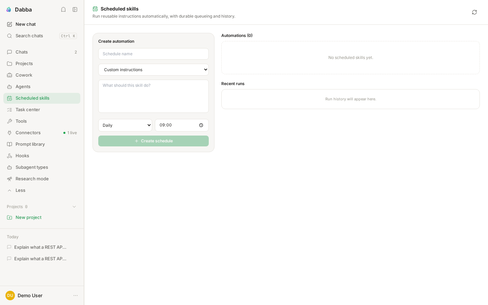

### Hooks

Run a shell command on agent events. A non-zero exit from a *Before a tool call* hook blocks that tool call.

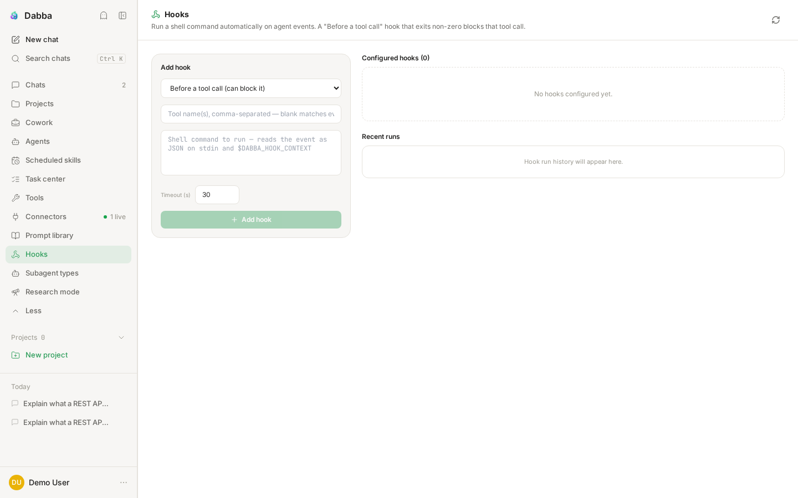

### Subagent types

Named personas with their own system prompt, tool allowlist, and model, which can be dispatched in parallel.

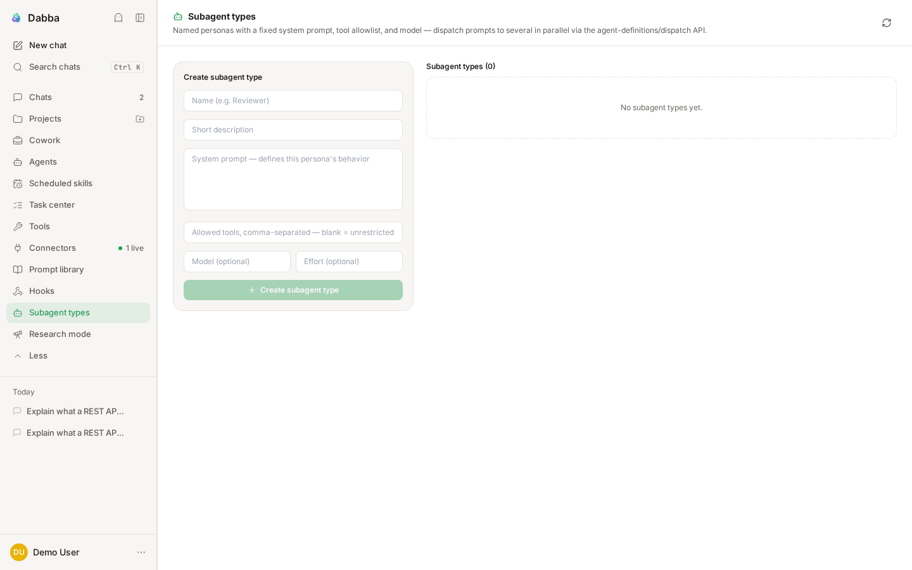

---

## Architecture

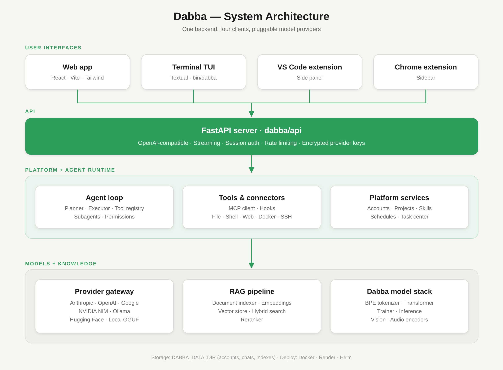

See [DABBA_ARCHITECTURE.md](DABBA_ARCHITECTURE.md) for the full design.

---

## Features

| Area | Highlights |
|---|---|
| **Chat** | Streaming replies, Markdown + KaTeX math, syntax highlighting, artifacts panel, regenerate, file and image upload, OCR, voice input, text-to-speech |
| **Export** | Download conversations or artifacts as PDF, DOCX, XLSX, or PPTX |
| **Agents** | Plan → act loop, native tool calling, permission prompts, subagents, research mode |
| **Tools** | File, shell, code, Docker, SSH, web, RAG, todo, and artifact tools |
| **Connectors** | MCP client with a curated connector catalogue |
| **Automation** | Scheduled skills, hooks on agent events, task center for run history and retries |
| **Providers** | Anthropic, OpenAI, Google, NVIDIA NIM, Ollama, Hugging Face, local GGUF, built-in `dabba` |
| **Security** | Session auth, owner/member roles (first account is the owner), encrypted provider keys (`DABBA_MASTER_KEY`), CORS allowlist, rate limiting |
| **Model stack** | BPE tokenizer, GQA/MQA attention, KV cache, gradient checkpointing, quantization, perplexity and latency benchmarks |

---

## Quick start

### Prerequisites

- Python 3.10+
- Node.js 22+ (for the web app)
- Optional: an API key for at least one hosted provider

### 1. Start the backend

```bash
pip install -r requirements-server.txt
export DABBA_CORS_ORIGINS=http://localhost:5173
python3 -m dabba.api.server            # listens on http://127.0.0.1:8080
```

Check it is running:

```bash
curl http://localhost:8080/health
```

### 2. Start the web app

```bash
cd frontend
npm install
npm run dev                            # http://localhost:5173
```

The Vite dev server proxies `/v1` to the backend. Set `VITE_API_URL` to point at a different server.

### 3. Create an account

Open the web app and sign up. The first account becomes the workspace owner, with access to Cowork, connectors, hooks and code execution. To give another account the same access later:

```bash
python3 -m dabba.platform.accounts [USER_EMAIL] --role admin
```

### Other clients

| Client | How to run |
|---|---|
| Terminal TUI | `bin/dabba` (or `python3 -m dabba.cli`) |
| VS Code | `cd vscode-extension && npx vsce package` then install the `.vsix` |
| Chrome | Load `chrome-extension/` as an unpacked extension |
| Any OpenAI client | Point the base URL at `http://localhost:8080/v1` |

See [HOW_TO_USE_DABBA.md](HOW_TO_USE_DABBA.md) for day-to-day usage.

---

## Configuration

Copy `.env.example` and set the values for your environment.

| Variable | Purpose |
|---|---|
| `DABBA_CORS_ORIGINS` | Comma-separated list of allowed browser origins |
| `DABBA_DATA_DIR` | Where accounts, chats, and indexes are stored |
| `DABBA_MASTER_KEY` | Fernet key used to encrypt stored provider keys. Keep it in a secret manager. |
| `DABBA_MODEL_PATH` | Local model path, or `rule_based` for a lightweight fallback |
| `DABBA_GUEST_CHAT`, `DABBA_GUEST_PROMPT_LIMIT`, `DABBA_GUEST_IP_DAILY_LIMIT` | Free prompts for signed-out visitors on `/try` (default on, 5 per visitor, 20 per IP per day). Replies use the server's `NVIDIA_API_KEY`; set `DABBA_GUEST_CHAT=0` to turn it off. |
| `SITE_URL` (build time) | Public address of the site, e.g. `https://dabba.example.com`. When set at build time, the app gets a canonical link and absolute social image, and `sitemap.xml` is generated. Pass it as a Docker build arg or a Cloudflare Pages build variable. |
| `DABBA_TRUSTED_PROXY_HOPS` | Reverse proxies in front of the server (default 1, right for Render), used to find a visitor's real IP for the guest limit. |
| `ANTHROPIC_API_KEY`, `OPENAI_API_KEY`, `GEMINI_API_KEY`, `NVIDIA_API_KEY`, `HF_TOKEN` | Provider keys, used when no key is saved in the app. Set them in your host's environment (e.g. Render's **Environment** tab) so no setup inside the app is needed. |

> [!IMPORTANT]
> Never commit real keys. Only placeholders belong in `.env.example`.

---

## Project structure

```text
.
├── dabba/                 # Python backend and model stack
│   ├── api/               # FastAPI server and endpoints
│   ├── platform/          # Accounts, projects, skills, provider gateway
│   ├── agent/             # Planner, executor, MCP client, tool registry
│   ├── providers/         # Anthropic, OpenAI, Google, NVIDIA, Ollama, HF, local
│   ├── tools/             # Built-in agent tools
│   ├── rag/               # Embeddings, vector store, hybrid search, reranker
│   ├── model/             # Decoder-only transformer
│   ├── tokenizer/         # BPE tokenizer
│   ├── trainer/           # Training loop, schedulers, checkpoints
│   ├── inference/         # Sampling, beam search, GGUF engine
│   ├── multimodal/        # Vision, audio, video encoders
│   ├── cli/               # Terminal TUI
│   ├── docs/              # Component documentation
│   └── tests/             # pytest suite
├── frontend/              # React + Vite + Tailwind web app
├── vscode-extension/      # VS Code side-panel client
├── chrome-extension/      # Chrome sidebar client
├── helm/                  # Kubernetes Helm chart
├── docs/                  # CI/CD, deployment, PR automation guides
├── Dockerfile             # Multi-stage image (frontend + API)
└── render.yaml            # Render deployment blueprint
```

---

## Testing

```bash
# Backend
pytest dabba/tests

# Frontend
cd frontend
npm run lint
npm test               # Vitest unit tests
npm run test:e2e       # Playwright (desktop + mobile)
```

CI runs on every pull request: lint, unit tests, CodeQL, and PR metadata checks. See [.github/workflows/](.github/workflows/).

---

## Deployment

| Target | Reference |
|---|---|
| Docker | `docker build -t dabba . && docker run -p 8080:8080 -v dabba-data:/data dabba` |
| Render | [render.yaml](render.yaml) and [docs/cloudflare-render-deployment.md](docs/cloudflare-render-deployment.md). On the free plan, enable Litestream + Cloudflare R2 to keep data across restarts. |
| Kubernetes | [helm/](helm/) |

The Docker image builds the web app and serves it from the API, runs as a non-root user, and exposes a `/ready` health check. It also bundles [Litestream](https://litestream.io): set `LITESTREAM_BUCKET` and the R2 variables to back up the SQLite databases to Cloudflare R2 and restore them on startup.

---

## Documentation

- [How to use Dabba](HOW_TO_USE_DABBA.md)
- [Architecture](DABBA_ARCHITECTURE.md)
- [VS Code extension architecture](VSCODE_EXTENSION_ARCHITECTURE.md)
- [Component docs](dabba/docs/index.md): installation, configuration, training, RAG, inference, API, deployment
- [CI/CD pipeline](docs/ci-cd-pipeline.md)
- [Pull request automation](docs/pull-request-automation.md)
